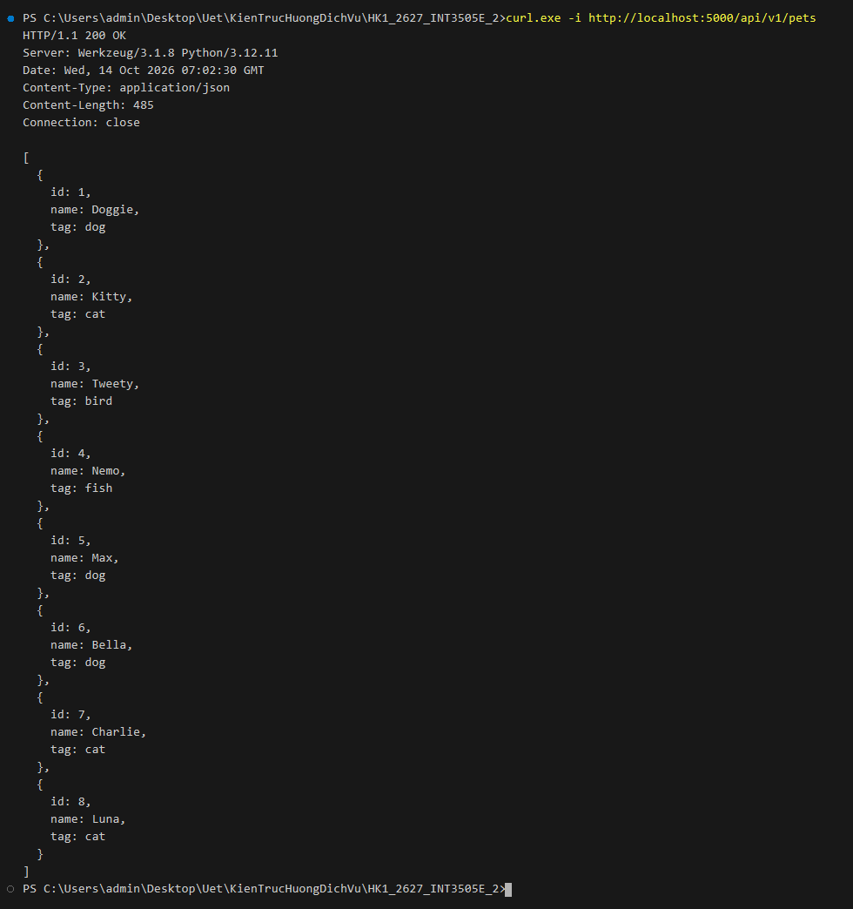
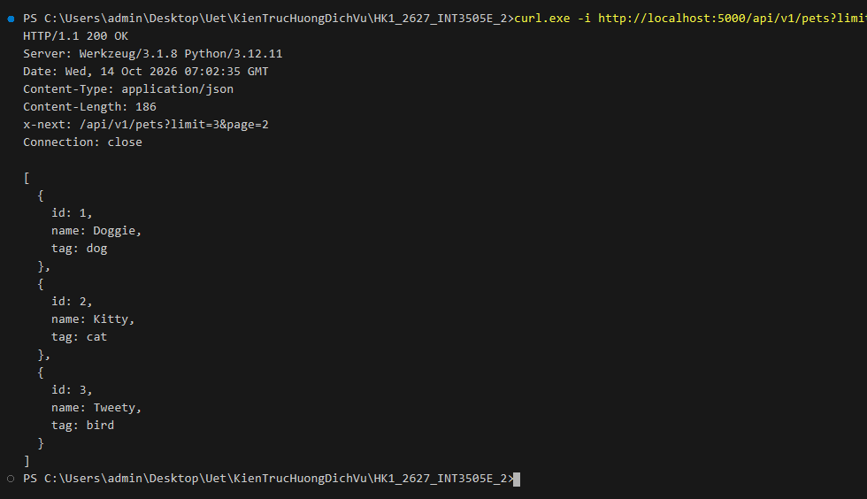
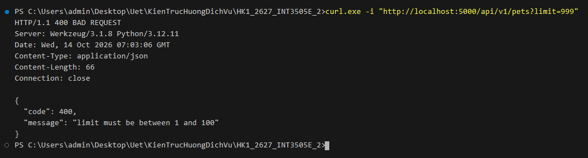
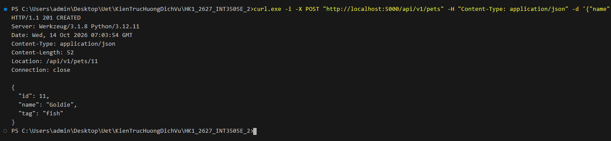
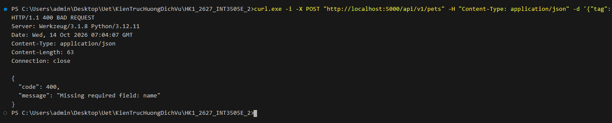
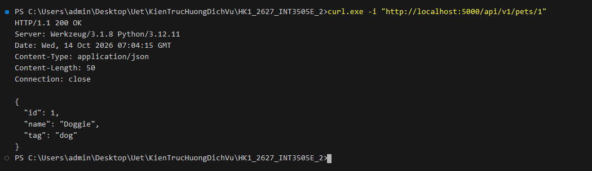
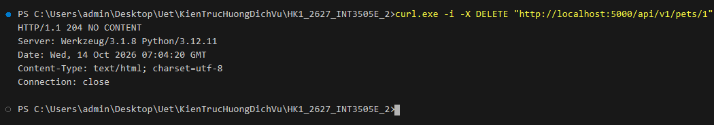
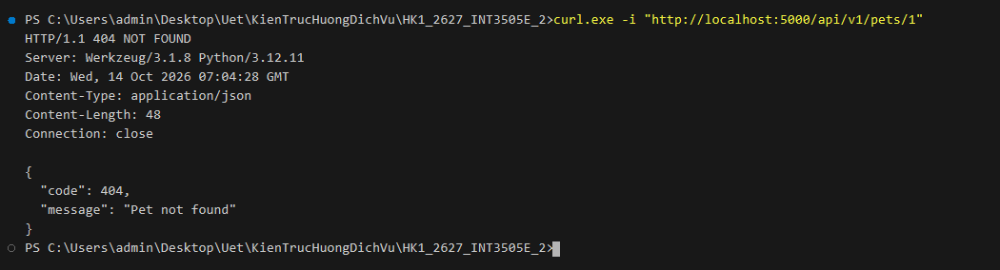

# Lab 4: Đặc tả RESTful API với OpenAPI Specification (OAS 3.0)

Thực hành viết đặc tả OpenAPI 3.0.3 (định dạng YAML) mô tả chuẩn hóa tài nguyên RESTful API, áp dụng kỹ thuật tái sử dụng schema (`$ref`), định danh hàm sinh mã (`operationId`), xử lý phản hồi lỗi chuẩn và khai báo cơ chế xác thực bảo mật (`securitySchemes`), đồng thời triển khai mã nguồn dịch vụ Web với Flask tương thích hoàn toàn với bản đặc tả.

---

## 1. Bài 1: Đặc tả OpenAPI YAML & Triển khai Flask API cho Pet Store

- **Tập tin đặc tả**: [`appB1.yaml`](./appB1.yaml)
- **Tập tin cài đặt**: [`appB1.py`](./appB1.py)
- **Chuẩn đặc tả**: OpenAPI 3.0.3
- **Base URL**: `http://localhost:5000/api/v1`

### 1.1. Các endpoint được khai báo

| Method | Endpoint | operationId | Mô tả | Request Body | Response thành công | Error Responses |
| :--- | :--- | :--- | :--- | :--- | :--- | :--- |
| `GET` | `/pets` | `listPets` | Lấy danh sách thú cưng (hỗ trợ phân trang qua query `limit`) | N/A | `200 OK` (`Pets`) kèm header `x-next` | `400`, `default` (`Error`) |
| `POST` | `/pets` | `createPets` | Thêm thú cưng mới vào cửa hàng | `NewPet` | `201 Created` (`Pet`) kèm header `Location` | `400`, `default` (`Error`) |
| `GET` | `/pets/{petId}` | `showPetById` | Xem thông tin chi tiết một thú cưng theo ID | N/A | `200 OK` (`Pet`) | `404`, `default` (`Error`) |
| `DELETE` | `/pets/{petId}` | `deletePet` | Xóa thú cưng khỏi hệ thống | N/A | `204 No Content` (body rỗng) | `404`, `default` (`Error`) |

---

### 1.2. Áp dụng 5 điểm kiến trúc cốt lõi từ bài giảng

1. **`operationId` duy nhất**:
   - Khai báo rõ ràng: `listPets`, `createPets`, `showPetById`, `deletePet`.
   - Phục vụ các công cụ sinh mã tự động (OpenAPI Generator, Swagger Codegen, SDK Generator) đặt tên hàm tương ứng trong client SDK.

2. **Tái sử dụng Schema (`$ref`)**:
   - Định nghĩa model `Pet` trong `#/components/schemas/Pet` gồm `id` (int64), `name` (string) và `tag` (string).
   - `Pets` được định nghĩa tái sử dụng: `type: array` chứa các phần tử `$ref: '#/components/schemas/Pet'`.
   - `NewPet` tách biệt cho request payload tạo mới (chỉ yêu cầu `name` và tùy chọn `tag`, không truyền `id` do server tự sinh).

3. **Bổ sung đầy đủ phản hồi lỗi (Error Responses)**:
   - Khai báo schema `Error` chuẩn gồm `code` (integer) và `message` (string).
   - Khai báo các status code lỗi thực tế: `400 Bad Request`, `404 Not Found` và nhánh `default` cho các ngoại lệ chưa lường trước.

4. **Tag nhóm endpoint**:
   - Khai báo nhóm `tags: [pets]` để gom nhóm các endpoint có liên quan, hỗ trợ hiển thị phân mục trực quan trên Swagger UI / Redoc.

5. **Cơ chế xác thực bảo mật (`securitySchemes`)**:
   - Định nghĩa `bearerAuth` (HTTP Bearer JWT) trong `#/components/securitySchemes`.
   - Áp dụng cấu hình `security` toàn cục.

---

### 1.3. Hướng dẫn chạy ứng dụng

Từ thư mục gốc dự án:
```powershell
python B4/appB1.py
```

---

### 1.4. Kết quả thực thi & Bằng chứng kiểm thử (Curl Screenshots)

*1. Lấy toàn bộ danh sách thú cưng ban đầu (`GET /api/v1/pets` - HTTP `200 OK`):*


*2. Phân trang với `limit=3`, server trả về danh sách kèm header `x-next` trỏ đến trang tiếp theo:*


*3. Kiểm định tham số đầu vào: `limit=999` vượt quá giới hạn tối đa 100 (`400 Bad Request` trả về schema `Error`):*


*4. Thêm thú cưng mới vào cửa hàng (`POST /api/v1/pets` - HTTP `201 Created` kèm header `Location`):*


*5. Kiểm định payload tạo mới khi thiếu trường bắt buộc `name` (`400 Bad Request` trả về schema `Error`):*


*6. Xem thông tin chi tiết một thú cưng theo ID (`GET /api/v1/pets/1` - HTTP `200 OK`):*


*7. Xóa thú cưng khỏi hệ thống (`DELETE /api/v1/pets/1` - HTTP `204 No Content` body rỗng):*


*8. Xác nhận thú cưng đã bị xóa khỏi hệ thống (`GET /api/v1/pets/1` - HTTP `404 Not Found` trả về schema `Error`):*

