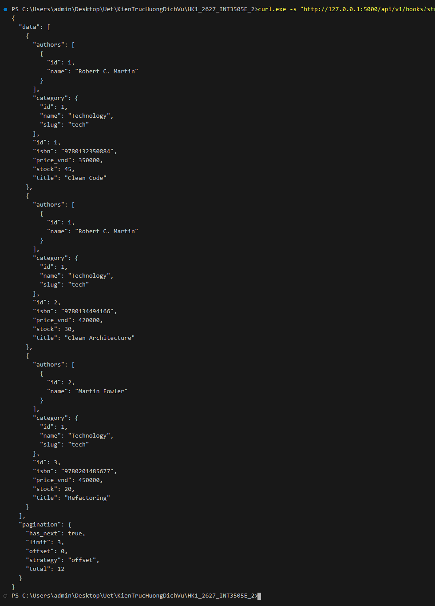
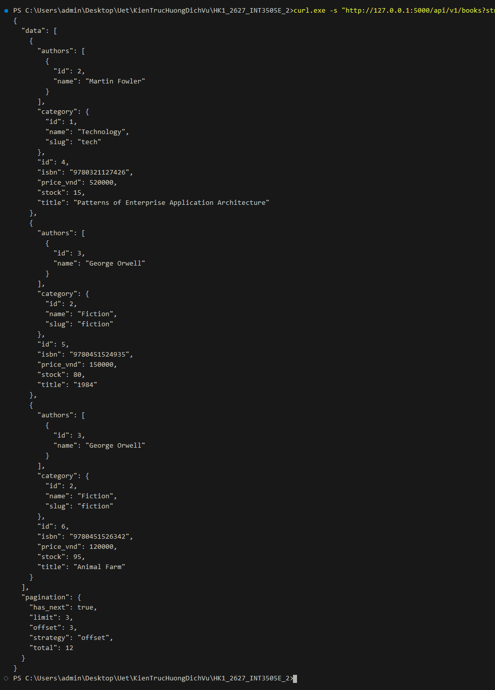
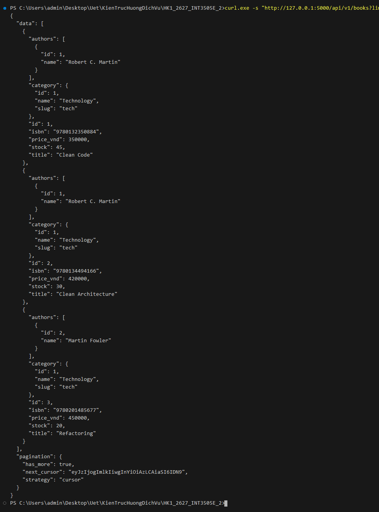
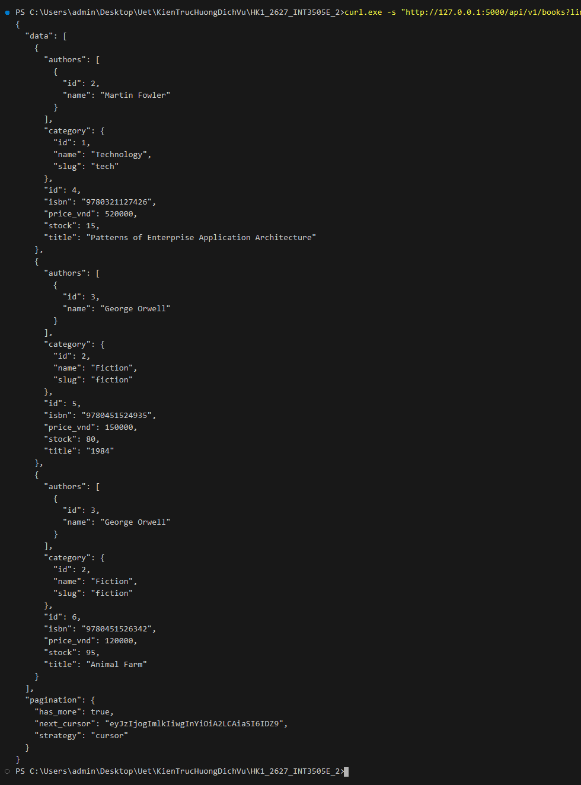
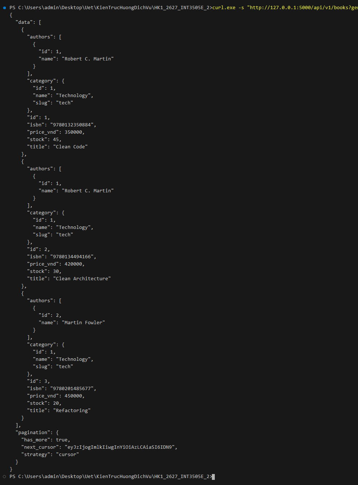
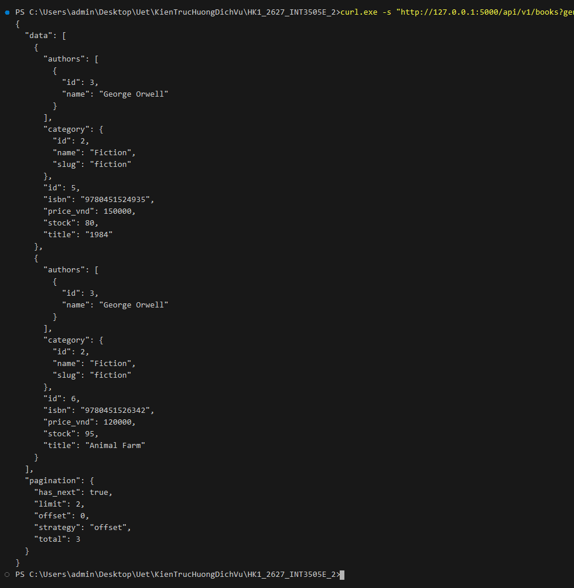
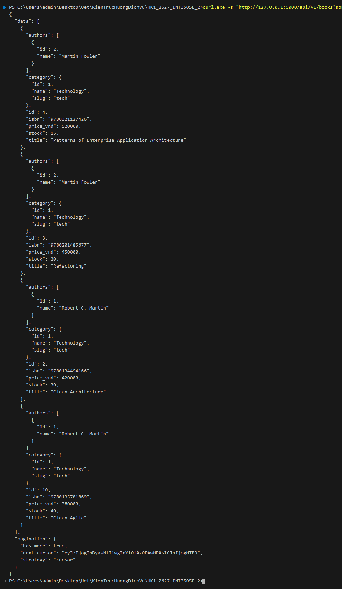
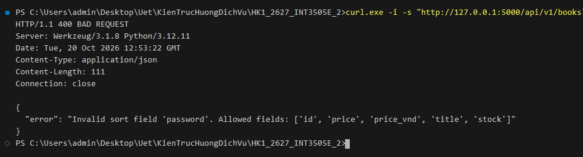

# Lab 5: Thiết kế Kiến trúc RESTful API - Phân trang, Lọc và Sắp xếp Nâng cao

Thực hành lập trình Backend (Flask API) xử lý phân trang dữ liệu theo 2 cơ chế song song (Offset/Limit và Composite Cursor Pagination), kết hợp bộ lọc (Filtering theo Category / Genre) và sắp xếp đa khóa (Multi-key Sorting) có kiểm định bảo mật Whitelist.

---

## 1. Bối cảnh & Cấu trúc Dự án Bookstore API

Cấu trúc thư mục được tối giản trong một file thực thi:
```text
B5/
├── appB1.py            # Toàn bộ mã nguồn ứng dụng Flask, models SQLAlchemy, seed data, phân trang & lọc/sắp xếp
└── schemas/
    └── book.json       # JSON Schema đặc tả thực thể Book (chuẩn Draft 2020-12)
```

---

## 2. Chi tiết các tính năng kỹ thuật được triển khai

### 2.1. Phân trang song song qua tham số `?strategy=...`
1. **Offset/Limit Pagination (`?strategy=offset`)**:
   - Query params: `offset` (mặc định 0), `limit` (mặc định 20, tối đa 100).
   - Truy vấn SQL `LIMIT ... OFFSET ...` kết hợp tính `total` số lượng bản ghi.
   - Cấu trúc phản hồi JSON:
     ```json
     {
       "data": [...],
       "pagination": {
         "strategy": "offset",
         "offset": 0,
         "limit": 20,
         "total": 12,
         "has_next": true
       }
     }
     ```

2. **Cursor-based Pagination (`?strategy=cursor` - mặc định nếu không truyền)**:
   - Query params: `limit` (mặc định 20, tối đa 100), `cursor` (chuỗi Base64).
   - Cơ chế **Composite Cursor (Con trỏ phức hợp)**: lưu trữ `{"s": sort_key, "v": sort_value, "i": last_id}` để tránh lỗi duplicate / skip khi các bản ghi có cùng giá trị sắp xếp.
   - Giải mã Base64 và lọc dữ liệu bằng so sánh bộ đôi (Tuple comparison):
     - Khi sắp xếp giảm dần (DESC): `WHERE (primary_column, id) < (sort_value, last_id)`
     - Khi sắp xếp tăng dần (ASC): `WHERE (primary_column, id) > (sort_value, last_id)`
   - Truy vấn `limit + 1` bản ghi nhằm xác định `has_more` và sinh `next_cursor` mà không cần truy vấn đếm `COUNT(*)` tốn kém tài nguyên.
   - Cấu trúc phản hồi JSON:
     ```json
     {
       "data": [...],
       "pagination": {
         "strategy": "cursor",
         "next_cursor": "eyJzIjogImlkIiwgInYiOiAzLCAiaSI6IDN9",
         "has_more": true
       }
     }
     ```

### 2.2. Bộ lọc dữ liệu (Filtering): `?genre=...`
- Cho phép lọc danh sách sách theo thể loại/danh mục thông qua tên danh mục (`name`) hoặc mã định danh (`slug`) (ví dụ: `?genre=tech`, `?genre=fiction`).
- Bộ lọc được kết hợp đồng bộ và chính xác với cả 2 cơ chế phân trang `offset` và `cursor`.

### 2.3. Sắp xếp đa khóa (Multi-key Sorting): `?sort=...`
- Cho phép client truyền nhiều trường sắp xếp đồng thời qua query param `?sort=...` ngăn cách bởi dấu phẩy (ví dụ: `?sort=-price,title`).
- Cú pháp: dấu trừ `-` biểu thị sắp xếp giảm dần (`DESC`), không có dấu biểu thị tăng dần (`ASC`).
- **Cơ chế bảo mật Whitelist**: Kiểm tra tính hợp lệ của các cột được phép sắp xếp (`id`, `price`, `price_vnd`, `title`, `stock`) nhằm ngăn chặn nguy cơ SQL Injection hoặc lộ cấu trúc DB. Khi client truyền trường ngoài whitelist, hệ thống phản hồi lỗi `400 Bad Request`.

---

## 3. Hướng dẫn chạy ứng dụng

Từ thư mục gốc dự án:
```powershell
python B5/appB1.py
```
*Ghi chú*: Cơ sở dữ liệu SQLite và dữ liệu mẫu sẽ được tự động khởi tạo khi ứng dụng khởi chạy lần đầu.

---

## 4. Kết quả thực thi & Bằng chứng kiểm thử (Curl Screenshots)

*1. Phân trang theo Offset/Limit - Trang đầu tiên (`strategy=offset&offset=0&limit=3` - HTTP 200 OK):*


*2. Phân trang theo Offset/Limit - Trang tiếp theo (`strategy=offset&offset=3&limit=3` - HTTP 200 OK):*


*3. Phân trang theo Cursor (mặc định) - Trang đầu tiên trả về `next_cursor` mã hóa Base64 (`limit=3` - HTTP 200 OK):*


*4. Phân trang theo Cursor - Sử dụng `cursor` phức hợp để lấy trang tiếp theo (`limit=3&cursor=...` - HTTP 200 OK):*


*5. Lọc sách theo thể loại danh mục (`?genre=tech` - HTTP 200 OK):*


*6. Kết hợp bộ lọc và phân trang Offset (`?genre=fiction&strategy=offset&limit=2` - HTTP 200 OK):*


*7. Sắp xếp đa khóa: Giá giảm dần, Tiêu đề tăng dần (`?sort=-price,title&limit=4` - HTTP 200 OK):*


*8. Cơ chế bảo vệ Whitelist: Từ chối trường sắp xếp lạ (`?sort=password` - HTTP 400 Bad Request):*

