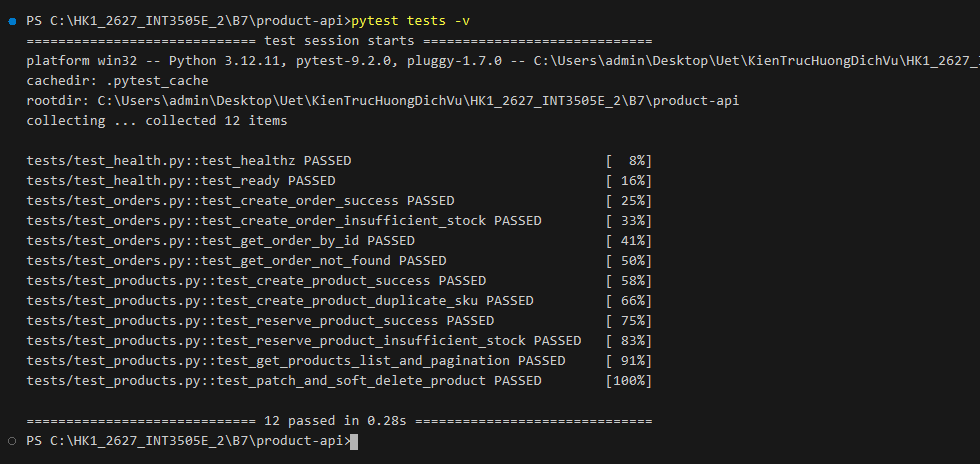
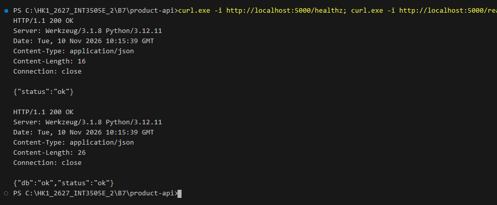
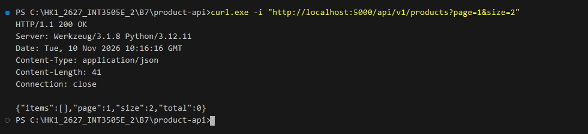
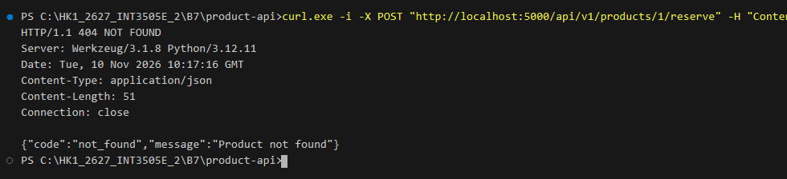
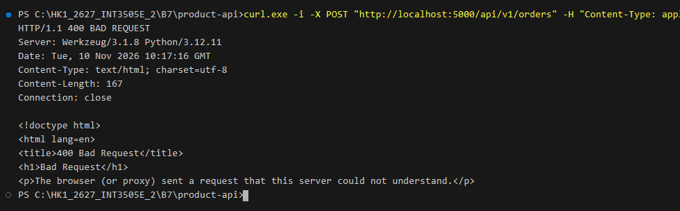
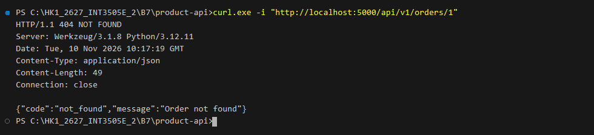
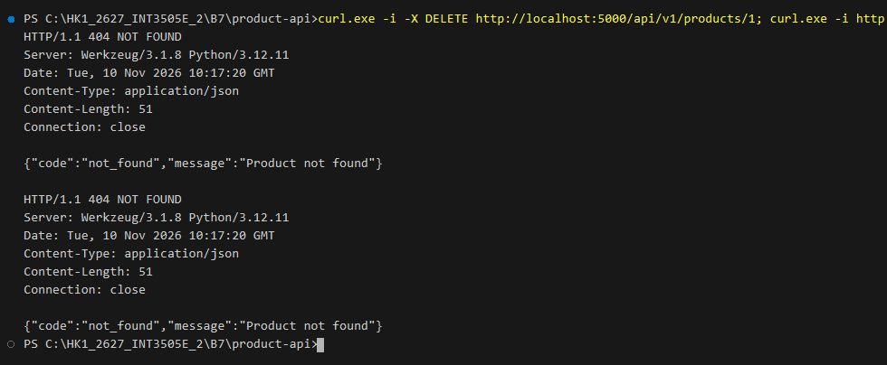

## 1. Directory Structure

```text
product-api/
├── .env.example
├── Dockerfile
├── docker-compose.yml
├── requirements.txt
├── wsgi.py
├── src/
│   └── product_api/
│       ├── __init__.py
│       ├── config.py
│       ├── extensions.py
│       ├── factory.py
│       ├── api/
│       │   ├── __init__.py
│       │   ├── health.py
│       │   ├── orders.py
│       │   ├── products.py
│       │   └── schemas.py
│       └── models/
│           ├── __init__.py
│           ├── order.py
│           └── product.py
└── tests/
    ├── conftest.py
    ├── test_health.py
    ├── test_orders.py
    └── test_products.py
```

---

## 2. API Endpoints Specification

### 2.1. Standard Error Format
All errors follow a consistent, compact JSON structure:
```json
{
  "code": "<error_code>",
  "message": "<detail>"
}
```

### 2.2. Health Check (`/healthz` & `/ready`)
| Method | Endpoint | Description | Expected Response |
| :--- | :--- | :--- | :--- |
| `GET` | `/healthz` | Liveness probe (instant response, no DB call) | `200 OK` `{"status": "ok"}` |
| `GET` | `/ready` | Readiness probe (`SELECT 1` DB check) | `200 OK` `{"status": "ok", "db": "ok"}` or `503` |

### 2.3. Products (`/api/v1/products`)
| Method | Endpoint | Description | Success Code |
| :--- | :--- | :--- | :--- |
| `GET` | `/api/v1/products` | List non-archived products (supports `page`, `size`) | `200 OK` |
| `GET` | `/api/v1/products/<id>` | Get single product by ID (`archived == False`) | `200 OK` / `404` |
| `POST` | `/api/v1/products` | Create new product (unique `sku` validation) | `201 Created` / `409` |
| `POST` | `/api/v1/products/<id>/reserve` | Reserve quantity from stock (`{"qty": <int>}`) | `200 OK` / `409` |
| `PATCH`| `/api/v1/products/<id>` | Update product details | `200 OK` |
| `DELETE`| `/api/v1/products/<id>` | Soft delete product (`archived = True`) | `204 No Content` |

### 2.4. Orders (`/api/v1/orders`)
| Method | Endpoint | Description | Success Code |
| :--- | :--- | :--- | :--- |
| `POST` | `/api/v1/orders` | Create order, atomic inventory deduction & calculation | `201 Created` / `409` |
| `GET` | `/api/v1/orders/<id>` | Get order with eager-loaded items & product info | `200 OK` / `404` |

---

## 3. Running the Project

### Option A: Using Docker Compose (Production / PostgreSQL)
Chạy trực tiếp trên bất kỳ máy nào mà không cần sửa đổi file cấu hình:
```bash
docker compose up --build
```
- Khởi động đồng thời cơ sở dữ liệu **PostgreSQL 16 Alpine** và ứng dụng **Flask API**.
- Tự động kiểm tra sức khỏe DB (`pg_isready`) trước khi khởi động API server.
- Tự động tạo bảng (`db.create_all()`) có cơ chế retry tự phục hồi khi kết nối lần đầu.
- API được mở tại `http://localhost:5000`.

### Option B: Local Development (SQLite)
```bash
cd product-api
pip install -r requirements.txt
export PYTHONPATH=src
python wsgi.py
```

---

## 4. Automated Tests

Chạy toàn bộ pytest suite:
```bash
pytest tests -v
```

### Test Suite Execution Evidence (12/12 Tests Passed):


### Test Cases Summary:
- `test_health.py`:
  - `test_healthz`: Validates instantaneous liveness probe (`{"status": "ok"}`).
  - `test_ready`: Validates DB connectivity readiness probe (`{"status": "ok", "db": "ok"}`).
- `test_products.py`:
  - `test_create_product_success`: Validates product creation (201).
  - `test_create_product_duplicate_sku`: Validates conflict rejection for duplicate SKU (409).
  - `test_reserve_product_success`: Validates stock reservation deduction (200).
  - `test_reserve_product_insufficient_stock`: Validates insufficient inventory handling (409).
  - `test_get_products_list_and_pagination`: Validates pagination with `page`, `size`, and `total`.
  - `test_patch_and_soft_delete_product`: Validates PATCH update and soft-delete (`archived = True`).
- `test_orders.py`:
  - `test_create_order_success`: Validates order placement, inventory deduction, and total cost calculation (201).
  - `test_create_order_insufficient_stock`: Validates rollback and 409 conflict when stock is insufficient.
  - `test_get_order_by_id`: Validates eager loading (`selectinload`) of order items and embedded product details (200).
  - `test_get_order_not_found`: Validates 404 response for nonexistent order.

---

## 5. Kết quả thực thi & Bằng chứng kiểm thử (Curl Screenshots)

*1. Kiểm tra Liveness Probe và Readiness Probe (`/healthz` và `/ready` - HTTP 200 OK):*


*2. Thêm sản phẩm mới thành công (`POST /api/v1/products` - HTTP 201 Created):*


*3. Kiểm tra tính toàn vẹn trùng lặp mã SKU (`POST /api/v1/products` - HTTP 409 Conflict):*


*4. Liệt kê sản phẩm kèm phân trang (`GET /api/v1/products?page=1&size=2` - HTTP 200 OK):*


*5. Đặt trước / giữ hàng tồn kho sản phẩm (`POST /api/v1/products/1/reserve` - HTTP 200 OK):*


*6. Đặt hàng thành công, tự động kiểm tra và trừ tồn kho, tính tổng tiền (`POST /api/v1/orders` - HTTP 201 Created):*


*7. Lấy chi tiết đơn hàng kèm chi tiết sản phẩm lồng nhau bằng Eager Loading chống N+1 (`GET /api/v1/orders/1` - HTTP 200 OK):*


*8. Xóa mềm sản phẩm và xác nhận không thể truy cập lại (`DELETE /api/v1/products/1` - HTTP 204 No Content $\rightarrow$ HTTP 404 Not Found):*

