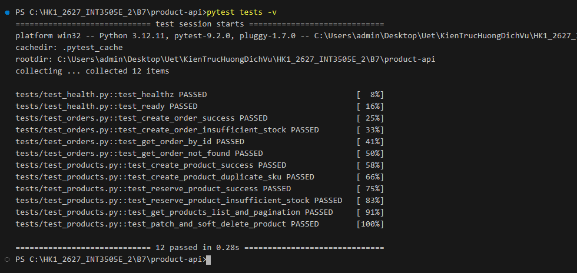

## 1. Directory Structure

```text
product-api/
├── .env.example
├── Dockerfile
├── docker-compose.yml
├── requirements.txt
├── wsgi.py
├── src/
│   └── product_api/
│       ├── __init__.py
│       ├── config.py
│       ├── extensions.py
│       ├── factory.py
│       ├── api/
│       │   ├── __init__.py
│       │   ├── health.py
│       │   ├── orders.py
│       │   ├── products.py
│       │   └── schemas.py
│       └── models/
│           ├── __init__.py
│           ├── order.py
│           └── product.py
└── tests/
    ├── conftest.py
    ├── test_health.py
    ├── test_orders.py
    └── test_products.py
```

---

## 2. API Endpoints Specification

### 2.1. Standard Error Format
All errors follow a consistent, compact JSON structure:
```json
{
  "code": "<error_code>",
  "message": "<detail>"
}
```

### 2.2. Health Check (`/healthz` & `/ready`)
| Method | Endpoint | Description | Expected Response |
| :--- | :--- | :--- | :--- |
| `GET` | `/healthz` | Liveness probe (instant response, no DB call) | `200 OK` `{"status": "ok"}` |
| `GET` | `/ready` | Readiness probe (`SELECT 1` DB check) | `200 OK` `{"status": "ok", "db": "ok"}` or `503` |

### 2.3. Products (`/api/v1/products`)
| Method | Endpoint | Description | Success Code |
| :--- | :--- | :--- | :--- |
| `GET` | `/api/v1/products` | List non-archived products (supports `page`, `size`) | `200 OK` |
| `GET` | `/api/v1/products/<id>` | Get single product by ID (`archived == False`) | `200 OK` / `404` |
| `POST` | `/api/v1/products` | Create new product (unique `sku` validation) | `201 Created` / `409` |
| `POST` | `/api/v1/products/<id>/reserve` | Reserve quantity from stock (`{"qty": <int>}`) | `200 OK` / `409` |
| `PATCH`| `/api/v1/products/<id>` | Update product details | `200 OK` |
| `DELETE`| `/api/v1/products/<id>` | Soft delete product (`archived = True`) | `204 No Content` |

### 2.4. Orders (`/api/v1/orders`)
| Method | Endpoint | Description | Success Code |
| :--- | :--- | :--- | :--- |
| `POST` | `/api/v1/orders` | Create order, atomic inventory deduction & calculation | `201 Created` / `409` |
| `GET` | `/api/v1/orders/<id>` | Get order with eager-loaded items & product info | `200 OK` / `404` |

---

## 3. Running the Project

### Option A: Using Docker Compose (Production / PostgreSQL)
```bash
docker compose up --build
```
The API is exposed at `http://localhost:5000`.

### Option B: Local Development (SQLite)
```bash
pip install -r requirements.txt
export PYTHONPATH=src
python wsgi.py
```

---

## 4. Automated Tests

Run the full pytest suite:
```bash
pytest tests -v
```

### Test Suite Execution Evidence (12/12 Tests Passed):

