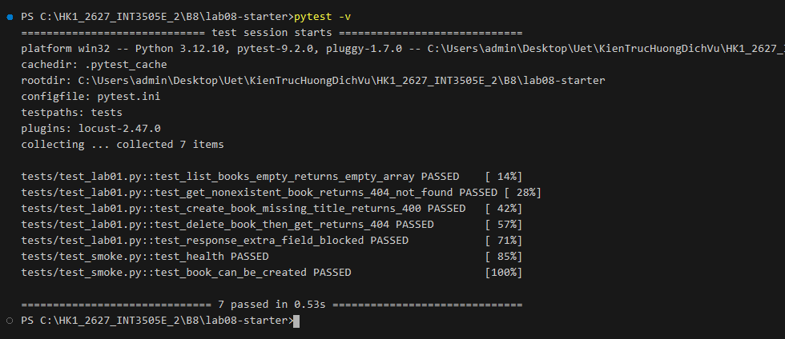
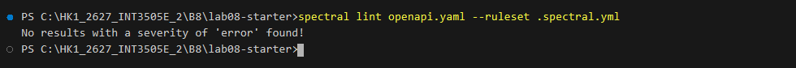
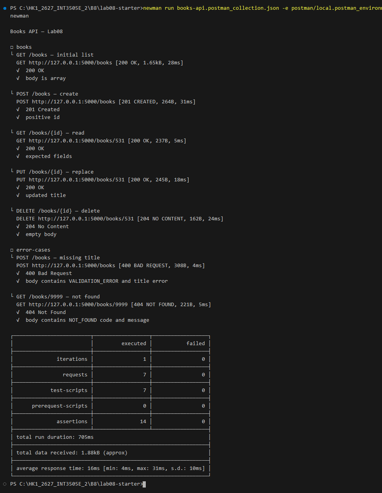

# Lab 8: API Testing, Contract Linting, Newman Automation & Load Testing

Mã nguồn thực hành được triển khai tại [`lab08-starter/`](./lab08-starter).

---

## 1. Lab 1 — Test Books API với Pytest & JSON Schema

- **Tập tin**: [`lab08-starter/tests/test_lab01.py`](./lab08-starter/tests/test_lab01.py), [`lab08-starter/pytest.ini`](./lab08-starter/pytest.ini)
- **Các test case đã cài đặt**:
  1. `test_list_books_empty_returns_empty_array`: `GET /books` khi CSDL rỗng trả về HTTP `200` và mảng `[]`.
  2. `test_get_nonexistent_book_returns_404_not_found`: `GET /books/9999` trả về HTTP `404` kèm `code: "NOT_FOUND"`.
  3. `test_create_book_missing_title_returns_400`: `POST /books` thiếu `title` trả về HTTP `400` kèm lỗi của field `"title"` trong `errors`.
  4. `test_delete_book_then_get_returns_404`: `POST` → `DELETE` (204) → `GET` lại cùng ID trả về HTTP `404`.
  5. **Bonus** `test_response_extra_field_blocked`: Dùng `jsonschema.validate()` với `Book` schema (`additionalProperties: false`) chứng minh response hợp lệ, không rò rỉ `password_hash`, và ném `ValidationError` khi giả lập thêm `password_hash`.

```powershell
cd B8/lab08-starter
.\.venv\Scripts\python.exe -m pytest -v
```
Kết quả: **7 passed in 0.87s** (< 2s, không in stack trace):


---

## 2. Lab 2 — Lint OpenAPI bằng Spectral

- **Tập tin**: [`lab08-starter/openapi.yaml`](./lab08-starter/openapi.yaml), [`lab08-starter/.spectral.yml`](./lab08-starter/.spectral.yml), [`lab08-starter/reports/spectral-lint.log`](./lab08-starter/reports/spectral-lint.log)
- **3 lỗi đã sửa trong `openapi.yaml`**:
  1. Bổ sung `operationId: listBooks` cho `GET /books`.
  2. Xóa `content` body không hợp lệ khỏi response `204` của `DELETE /books/{id}`.
  3. Đổi kiểu của `Book.year` từ `type: string` sang `type: integer` (với `nullable: true`) khớp model SQLAlchemy.
- **Custom rules trong `.spectral.yml`**:
  - `response-200-non-empty-schema`: Kiểm tra mọi response `200` `application/json` phải khai báo ít nhất 1 trường (`minProperties: 1`) trong `schema.properties` (hoặc `schema.items.properties` nếu là mảng), giúp phát hiện sớm các endpoint trả `200` nhưng quên định nghĩa schema dữ liệu.
  - `no-204-response-body`: Cấm khai báo `content` body ở HTTP `204`.
  - `book-year-integer`: Khẳng định `Book.year` phải là `integer`.
- **Phân tích**: Xem chi tiết câu trả lời tại [`lab08-starter/reports/lab02-analysis.md`](./lab08-starter/reports/lab02-analysis.md) (Spectral chỉ lint tĩnh file YAML; để bắt sai khác giữa OpenAPI spec và code Flask thực tế cần **Contract Test / Schema Validation Integration Test** dùng `pytest` + `jsonschema`).



---

## 3. Lab 3 — Newman-runnable Postman Collection

- **Tập tin**: [`lab08-starter/books-api.postman_collection.json`](./lab08-starter/books-api.postman_collection.json), [`lab08-starter/postman/local.postman_environment.json`](./lab08-starter/postman/local.postman_environment.json)
- **Mở rộng collection**:
  - Giữ nguyên 5 happy-path requests trong thư mục `books/` (lưu `book_id` từ `POST /books` qua `pm.collectionVariables.set("book_id", ...)` và tái sử dụng ở `GET`, `PUT`, `DELETE`).
  - Thêm thư mục `error-cases/` gồm `POST /books — missing title` (`400`) và `GET /books/9999 — not found` (`404`), mỗi request có 2 block `pm.test` kiểm tra HTTP status và nội dung body (`code`, `message`/`errors`).
- **Script chạy lại & Báo cáo JUnit**:
  - Script chạy lại: [`lab08-starter/run_newman.sh`](./lab08-starter/run_newman.sh) / [`lab08-starter/run_newman.ps1`](./lab08-starter/run_newman.ps1)
  - Báo cáo xuất ra: [`lab08-starter/reports/junit.xml`](./lab08-starter/reports/junit.xml) (7 testsuites, 14 assertions, 0 failures, tổng thời gian ~664ms < 10s).



---

## 4. Lab 4 — Load Test Books API với Locust

- **Tập tin**: [`lab08-starter/performance/locustfile.py`](./lab08-starter/performance/locustfile.py), [`lab08-starter/performance/analysis.md`](./lab08-starter/performance/analysis.md)
- **Task bổ sung**: `search_by_year(year)` gọi `GET /books?year={year}` có tiêm lỗi giả lập `1%` phía client qua `response.failure(...)` (không phải HTTP 500 thật từ Flask).
- **Báo cáo HTML đã xuất tại `lab08-starter/reports/`**:
  - [`A.html`](./lab08-starter/reports/A.html): Baseline nhẹ (`10` users, `2/s`, `30s`) → 134 reqs, p95 = **19 ms**, fail rate = **0.75%**, RPS = **4.73**
  - [`B.html`](./lab08-starter/reports/B.html): Load test (`50` users, `5/s`, `60s`) → 1,317 reqs, p95 = **180 ms** (`POST /books` p95 = 530 ms), fail rate = **0.30%**, RPS = **22.88**
  - [`C.html`](./lab08-starter/reports/C.html): Spike test (`200` users, `50/s`, `30s`) → 2,758 reqs, p95 = **470 ms** (`POST /books` p95 = 740 ms), fail rate = **0.40%**, RPS = **93.97**
- Phân tích đầy đủ 4 câu hỏi (kể cả câu bonus connection pool = 5): [`lab08-starter/performance/analysis.md`](./lab08-starter/performance/analysis.md).
