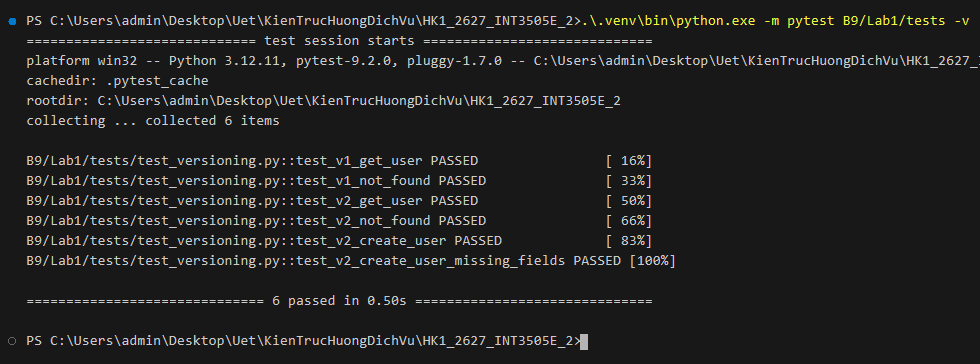
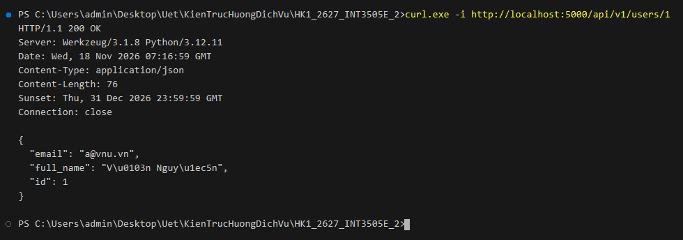
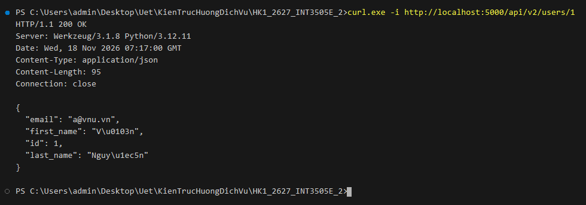
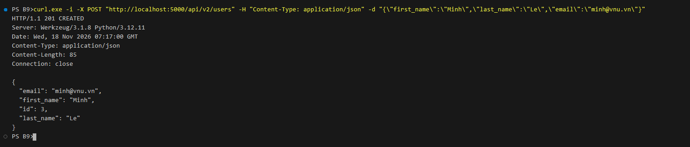
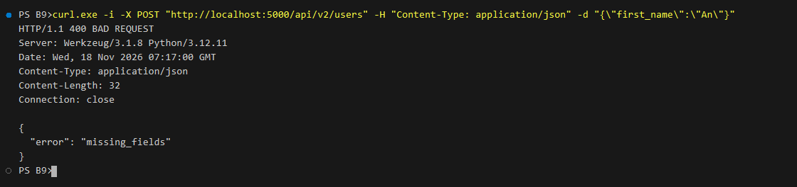
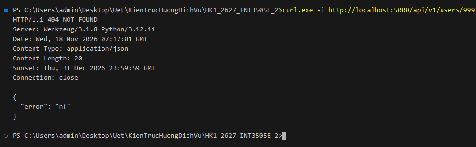

# Lab 9: API Versioning với Flask Blueprints

Thực hành quản lý phiên bản API theo đường dẫn (`/api/v1` và `/api/v2`), gắn header `Sunset` cho `v1`, mở rộng `POST /users` cho `v2` và đặc tả OpenAPI.

---

## 1. Cấu trúc thư mục

```text
B9/
├── README.md
└── Lab1/
    ├── app.py                  # Đăng ký blueprints /api/v1 và /api/v2
    ├── openapi.yaml            # Đặc tả OpenAPI 3.0.3
    ├── blueprints/
    │   ├── __init__.py
    │   ├── users_data.py       # Dữ liệu mẫu và hàm get_user, create_user
    │   ├── v1.py               # GET /users/<uid> (full_name) + Sunset header
    │   └── v2.py               # GET /users/<uid> + POST /users
    └── tests/
        └── test_versioning.py  # 6 test cases với Pytest
```

---

## 2. Các endpoint chính

| Phiên bản | Endpoint | Mô tả |
| :--- | :--- | :--- |
| **v1** | `GET /api/v1/users/<uid>` | Trả về `full_name`; gắn header `Sunset: Thu, 31 Dec 2026 23:59:59 GMT` |
| **v2** | `GET /api/v2/users/<uid>` | Tách thành `first_name` và `last_name` |
| **v2** | `POST /api/v2/users` | Tạo user mới (`first_name`, `last_name`, `email`), trả về `201` hoặc `400` |

Đặc tả OpenAPI xem tại [`Lab1/openapi.yaml`](./Lab1/openapi.yaml).

---

## 3. Chạy ứng dụng & Kiểm thử

```powershell
# Chạy server
cd B9/Lab1
..\..\.venv\bin\python.exe app.py

# Chạy pytest (từ thư mục gốc)
.\.venv\bin\python.exe -m pytest B9/Lab1/tests -v
```



---

## 4. Kết quả chạy `curl`

*1. `GET /api/v1/users/1` (`200 OK` + header `Sunset`):*


*2. `GET /api/v2/users/1` (`200 OK`):*


*3. `POST /api/v2/users` (`201 CREATED`):*


*4. `POST /api/v2/users` thiếu trường (`400 BAD REQUEST`):*


*5. `GET /api/v1/users/999` (`404 NOT FOUND` + header `Sunset`):*

